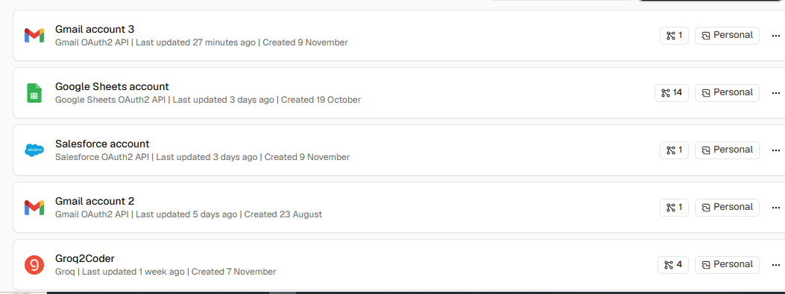
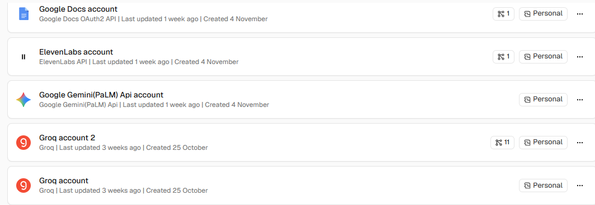

# TP4 - Cinco Sentidos - Manager Multicanal

## Proyecto Integrador - Módulo 4 | AI Automation Avanzado (Coderhouse)

**Alumna:** María Laura Menafra  
**Proyecto:** Cinco Sentidos - Asistente de Cosmetología  
**Plataforma:** n8n Cloud

---

## Descripción

Workflow Manager Multicanal que recibe consultas por **Gmail** y **Telegram**, las clasifica mediante un LLM (Groq) y las rutea a sub-workflows especializados (Workers) según el tipo de consulta: productos, tratamientos, turnos u otros.

### Arquitectura

```
Gmail / Telegram → Unificar canal → Clasificador LLM (Groq)
    → Switch por intención:
        - producto    → Worker Productos
        - tratamiento → Worker Tratamientos
        - turno/otro  → Respuesta directa
    → Respuesta al cliente (canal original)
    → Guardar memoria (Google Sheets)
    → Notificación supervisión (Slack)
```

## Archivos incluidos

| Archivo | Descripción |
|---------|-------------|
| `checkpoint4_María.Laura_Menafra.json` | Workflow Manager Multicanal (JSON para importar en n8n) |
| `TP4_Cinco_Sentidos_Manager_Multicanal.json` | Versión corregida del Manager |
| `TP4 - Worker Productos.json` | Sub-workflow especializado en consultas de productos |
| `TP4 - Worker Tratamientos.json` | Sub-workflow especializado en consultas de tratamientos |
| `Credenciales.docx` | Documento de credenciales |
| `Datos de pruebas de flujo.docx` | Datos utilizados para pruebas del flujo |

## Credenciales configuradas en n8n

A continuación se muestran las credenciales configuradas en la instancia de n8n Cloud para este proyecto:

### Listado de credenciales (parte 1)



- **Gmail account 3** — Gmail OAuth2 API (trigger y creación de borradores HITL)
- **Google Sheets account** — Google Sheets OAuth2 API (memoria de sesiones)
- **Salesforce account** — Salesforce OAuth2 API (integración CRM - bypass por expiración OAuth)
- **Gmail account 2** — Gmail OAuth2 API (cuenta secundaria)
- **Groq2Coder** — Groq API (modelo LLM para clasificación de consultas)

### Listado de credenciales (parte 2)



- **Google Docs account** — Google Docs OAuth2 API
- **ElevenLabs account** — ElevenLabs API
- **Google Gemini (PaLM) Api account** — Google Gemini API
- **Groq account 2** — Groq API (instancia secundaria)
- **Groq account** — Groq API

## Criterios de evaluación (Rúbrica TP4)

| Criterio | Peso | Implementación |
|----------|------|----------------|
| **Conectividad Segura** | 40% | OAuth2 para Gmail, Google Sheets, Salesforce y Slack. API Key para Groq y Telegram Bot Token. Todas las credenciales almacenadas de forma segura en n8n Cloud. |
| **Contención de Bucles y Mitigación de Errores** | 35% | Detección de duplicados (evento ya procesado), `onError: continueRegularOutput` en nodos críticos, validación de JSON del LLM con fallback, control de respuestas automáticas de Gmail. |
| **Gobernanza Operativa e Interfaz HITL** | 25% | Borradores Gmail para revisión humana (Human-in-the-Loop), notificaciones Slack al equipo supervisor, registro de eventos procesados, memoria persistente en Google Sheets. |

---

*Entrega 4 - Módulo 4 - AI Automation Avanzado - Coderhouse 2026*
